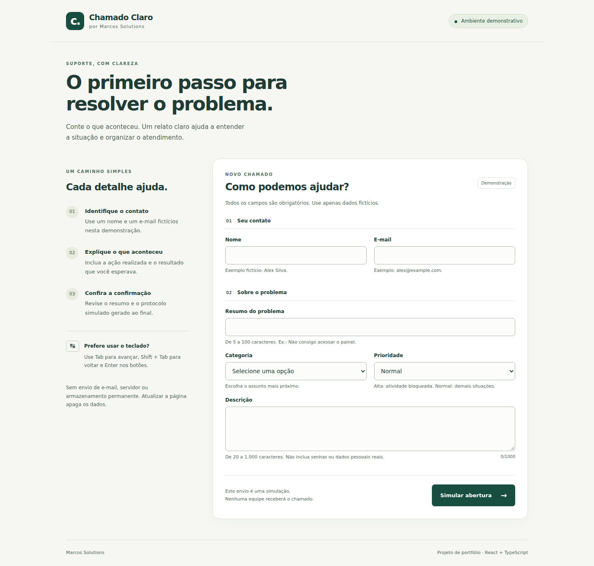

# Chamado Claro

A focused React + TypeScript portfolio project exploring error recovery in a support request form.

People often abandon forms when they cannot identify what failed or where to continue. This demo keeps their input, groups actionable errors and moves keyboard focus to the next meaningful location.



## Try it locally

Requires Node.js 24 or newer and npm. Extract the complete project folder, open a terminal inside it, then run:

```bash
npm ci
npm run dev
```

Open the local address printed by Vite, usually http://127.0.0.1:5173. Do not open `index.html` directly from the filesystem. The app is in Brazilian Portuguese.

## What you can demonstrate

1. Enter a fictitious name and submit an incomplete form.
2. The form preserves input and focuses a summary of the remaining errors.
3. Activate an error link to focus its field.
4. Complete the fields using Tab, Shift+Tab and the arrow keys for native selects.
5. Submit and read the simulated confirmation; start again to return focus to the name field.

[Watch the recorded browser flow](media/chamado-claro.mp4) · [Error recovery screenshot](media/02-erros.png) · [Confirmation](media/03-confirmacao.png) · [Mobile](media/04-mobile.png)

This is a local demonstration: no real ticket, email, API request or durable storage is created. Refreshing clears the form and confirmation. Use fictitious data only. The protocol is a random display identifier, not a server-issued ticket number.

## Features

- Explicit labels, native inputs/selects, fieldsets and legends.
- Text instructions, inline error messages and an error summary linked to fields.
- `aria-invalid` and `aria-describedby` connect fields to their validation state and messages.
- Skip link, visible focus indicators, keyboard navigation and focus restoration.
- Required fields, trimmed length boundaries, basic email shape and enum validation.
- Responsive layout, including automated overflow checks at 390 px and 320 px.
- Confirmation view, preserved input after failure and deliberate reset.

## Architecture and decisions

- `src/validation.ts`: pure validation and normalization, independent from React.
- `src/App.tsx`: form and confirmation state, semantic UI and focus transitions.
- `src/styles.css`: plain CSS and system fonts, without a UI framework or external font request.
- `tests/validation.test.ts`: rule boundaries and normalization.
- `tests/form.spec.ts`: browser behavior and automated accessibility checks.

The small scope does not need routing, a state management library or an API. Controlled React state keeps typed input and confirmation consistent. Validation runs on submission rather than on each keystroke, so feedback does not interrupt typing; old messages remain until the next submission. After failure, focus moves to the error summary. After success, it moves to the confirmation heading. Reset returns focus to the first field.

The custom summary uses `noValidate` on the form so browser popups do not compete with the error recovery flow. Required attributes remain on individual controls. Focus is used to expose the summary instead of combining it with a potentially duplicated live announcement. Actual screen-reader behavior still requires manual review.

No `dangerouslySetInnerHTML` is used; React renders submitted text as text. Client-side validation is a usability feature, not a security boundary. A production API would need independent validation, authorization, rate limits, persistence and error handling.

## Verification

```bash
npm test
npm run build
npx playwright install chromium
npm run test:e2e
```

On Linux CI, use `npx playwright install --with-deps chromium`. The included workflow runs these checks when you publish the repository; it has not been executed on GitHub in this delivery.

Verified on 12 October 2026 with Node 24.19.0 and headless Chromium 153:

- 8/8 validation tests passed.
- 5/5 browser tests passed.
- TypeScript checking and production build passed.
- No axe violations for the selected `wcag2a`, `wcag2aa`, `wcag21aa` tags in the initial, error and confirmation states.
- Production dependency audit reported zero known advisories at the time of the run. This is not a security guarantee.

The local execution environment used a custom Chromium executable via `CHROMIUM_PATH`. You can normally omit that variable after installing Playwright's Chromium. The lockfile records the resolved dependencies.

See [validation report](docs/VALIDATION.md), [raw unit output](docs/unit-test-output.txt) and [browser results](docs/browser-test-results.json).

## Limits and next steps

This is not a WCAG conformance claim. Automated checks cover only part of accessibility. NVDA, VoiceOver, Firefox, Safari, real mobile devices, high contrast mode and user testing have not been verified. The narrow viewport test is not a substitute for testing actual browser zoom. The email check validates a basic shape, not deliverability. Lengths use JavaScript UTF-16 code units.

Future work: manual assistive-technology review; a server API with error/retry handling; integration tests for network failures. These are not implemented.

## Media and documentation

The PNG files are unaltered browser screenshots. The silent MP4 records real scripted browser interaction, with pauses for readability; it is not a performance benchmark. Regenerate with a preview server running on port 4173:

```bash
npx playwright install chromium ffmpeg
node scripts/capture.mjs
ffmpeg -i media/chamado-claro.webm -c:v libx264 -pix_fmt yuv420p -movflags +faststart media/chamado-claro.mp4
```

FFmpeg is needed only for MP4 conversion, not to run the app. [Five-day study plan](docs/ROTEIRO-5-DIAS.md) · [LinkedIn draft](docs/LINKEDIN.md) · [Publishing checklist](docs/PUBLICAR.md).

Built as a small portfolio exercise for Marcos Neves / Marcos Solutions. No external platform was published as part of this delivery.
